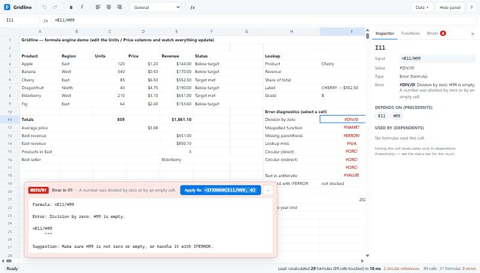

# Gridline — Spreadsheet Web Application

A spreadsheet that runs in the browser, written in TypeScript. It has a virtualized grid with 100,000 rows × 702 columns (A–ZZ) and its own formula engine: a hand-written tokenizer, Pratt parser and evaluator with **112 functions**, dependency tracking that recalculates only the cells affected by a change, circular-reference detection, and error diagnostics that point at the problem with a caret and offer a one-click fix.

No spreadsheet or formula library is used. The only runtime dependencies are React and Zustand.

**Live demo:** _add your GitHub Pages URL here after deploying (see [Deployment](#deployment))._



## Features

| Requirement | What's implemented |
| --- | --- |
| **Grid & editing** | Virtualized grid (only visible rows/columns are rendered, and only non-empty cells create DOM nodes) · click, drag, Shift-click, header and select-all selection · in-cell editor and formula bar sharing one draft · keyboard navigation (arrows, Ctrl+arrows, Tab/Enter, Home/End, PageUp/Down) · drag-to-fill (series, text increments, formulas) · undo/redo of every change · copy/cut/paste with reference shifting · column resizing · bold/italic/alignment/number formats · CSV import/export · autosave |
| **Custom formula engine** | Tokenizer → Pratt parser → AST → tree-walking evaluator, all hand-written · **112 functions** across math, statistics, logic, text, lookup, information and dates, including SUM, IF and VLOOKUP ([full list](docs/FUNCTIONS.md)) |
| **Expressions** | `+ - * / ^ %`, `&`, comparisons, unary minus, parentheses, cell references (`A1`, `$A$1`, mixed), ranges (`A1:C10`, `A:A`, `2:5`), nested formulas and nested function calls, with Excel's precedence and coercion rules |
| **Dependency tracking** | Dependency graph with reverse edges and a spatial index for ranges · after an edit, an iterative Tarjan pass visits **only** the affected cells and evaluates each once in topological order · the status bar shows how many formulas each edit recalculated |
| **Circular references** | Direct, indirect and range-based cycles are detected during the same pass, with no infinite loops or stack overflows (5,000-cell cycles are covered by tests) · each cell shows the cycle path, e.g. `A1 → B1 → C1 → A1` |
| **Error diagnostics** | Every error has a message, a caret under the offending part of the formula, a suggestion and (when one can be derived and checked to compile) an **Apply fix** button · live checking while typing · propagated errors name their origin with **Go to source** · Errors panel lists every error in the sheet |

Also included: function autocomplete with signature help, click-to-insert references while typing a formula (with coloured highlights of each reference), a cell inspector showing precedents and dependents, a searchable function browser, a status bar with Sum/Average/Min/Max/Count of the selection, light and dark themes, and a responsive layout.

## Quick start

Requires **Node.js 18+** (developed on Node 24).

```bash
npm install
```

```bash
npm run dev
```

Then open http://localhost:5173. The app starts with a demo sheet that shows formulas, lookups and every kind of error. **Data ▸ Generate 10,000 rows** loads an 80,000-cell dataset (30,000 formulas, including a running total that chains through all 10,000 rows) to try the grid and recalculation at scale.

### Scripts

| Command | Purpose |
| --- | --- |
| `npm run dev` | Start the Vite dev server |
| `npm test` | Run the 280 unit tests (Vitest) |
| `npm run build` | Type-check everything and produce a static production build in `dist/` |
| `npm run preview` | Serve the production build locally |
| `npm run bench` | Benchmark engine load and incremental recalculation |
| `npm run docs:functions` | Regenerate [docs/FUNCTIONS.md](docs/FUNCTIONS.md) from the function registry |
| `npm run typecheck` | Strict TypeScript check of the app, tests and scripts |

## Using the app

- **Type** in any cell to replace its content; start with `=` for a formula. **F2** or double-click edits the existing content.
- While typing a formula, **click or drag on cells** to insert references, pick functions from the **autocomplete list** (↑/↓, Tab), and read the **signature hint** for the current argument.
- Select an error cell to see its **diagnostic**; press **Apply fix** when a correction is offered.
- Drag the small **■ handle** at the bottom-right of the selection to fill down or right.
- The **Inspector** tab shows a cell's precedents and dependents; **Functions** lists every function with examples; **Errors** lists every error cell.
- Press **?** in the toolbar for all keyboard shortcuts.

| Shortcut | Action |
| --- | --- |
| Arrows / Shift+Arrows / Ctrl+Arrows | Move / extend selection / jump to the edge of the data |
| Enter, Tab (Shift to reverse) | Commit and move |
| F2, Escape | Edit, cancel |
| Delete | Clear the selected cells |
| Ctrl+C / X / V | Copy / cut / paste (relative references shift) |
| Ctrl+Z / Ctrl+Y | Undo / redo |
| Ctrl+B / Ctrl+I | Bold / italic |
| F9 | Recalculate everything |

## Error diagnostic example

Typing `=SUM(A1, B2` shows:

```
Formula: =SUM(A1, B2

Error: Missing closing parenthesis.

=SUM(A1, B2
           ^

Suggestion: Add ')' at the end of the formula.
```

with an **Apply fix: `=SUM(A1, B2)`** button. More examples:

| Formula | Diagnostic |
| --- | --- |
| `=SUMM(A1:A3)` | `#NAME?` Unknown function 'SUMM'. *Did you mean SUM?* (fix offered) |
| `=A1/B1` with B1 = 0 | `#DIV/0!` Division by zero: B1 is 0. Caret under `B1`; fix `=IFERROR(A1/B1, 0)` |
| `=IF(A1, 1, 2, 3)` | IF expects 2 to 3 arguments, but got 4. *Usage: IF(logical_test, value_if_true, [value_if_false])* |
| `=SUM(A1 B1)` | Missing ',' between 'A1' and 'B1'. Fix `=SUM(A1, B1)` |
| `=A1!=B1` | '!=' is not a valid operator. *Use '<>'* (fix offered) |
| `=CONCAT("abc` | Missing closing quote. Fix `=CONCAT("abc")` (quote and parenthesis repaired together) |
| `=B1:B3*2` | The range B1:B3 can't be used as a single value. Fix `=SUM(B1:B3)*2` |
| `=VLOOKUP("Kiwi", A2:C9, 3, FALSE)` | `#N/A` VLOOKUP could not find the text "Kiwi" in the first column of A2:C9, with a suggestion to check the value or use IFNA |
| `A1: =B1`, `B1: =A1` | `#CIRC!` Circular reference: A1 → B1 → A1 |
| `=5+B1` where B1 shows an error from A1 | B1 contains #DIV/0! (originating in A1): … with a **Go to source** button |

## How it works

A full write-up is in **[docs/ARCHITECTURE.md](docs/ARCHITECTURE.md)**. In short:

- **Parser** ([tokenizer.ts](src/engine/tokenizer.ts), [parser.ts](src/engine/parser.ts), [compile.ts](src/engine/compile.ts)). A tokenizer that never throws feeds a Pratt parser with Excel precedence. Every AST node keeps its source offsets. Syntax errors carry a span, a suggestion and a candidate fix. A validation pass checks function names (with Levenshtein "did you mean") and argument counts. Fixes are only offered after re-compiling them successfully.
- **Evaluator** ([evaluator.ts](src/engine/evaluator.ts), [functions/](src/engine/functions)). A tree-walking interpreter with spreadsheet coercion rules. Errors are values that propagate and are re-positioned at the reference that read them. Function arguments are evaluated lazily (so `IF`/`IFERROR`/`CHOOSE` short-circuit). Ranges are lazy views clamped to the used area, so `SUM(A:A)` stays cheap. Functions are declarative specs, and the same registry drives validation, autocomplete, the in-app browser and the generated docs.
- **Dependency tracking** ([dependency-graph.ts](src/engine/dependency-graph.ts), [engine.ts](src/engine/engine.ts)). Single-cell references are stored as reverse edges. Ranges go into a spatial index (256-row buckets per column) instead of being expanded. A change triggers an iterative Tarjan SCC traversal from the edited cells. That visits only the affected cells, gives a topological evaluation order (each cell evaluated once) and finds cycles as strongly connected components, which receive `#CIRC!` with the cycle path.

### Performance

From `npm run bench` (Node 24):

| Dataset | Operation | Formulas evaluated | Time |
| --- | --- | ---: | ---: |
| 80k cells / 30k formulas | Initial load (parse + calculate) | 30,008 | ~250 ms |
| | Edit the first price (running total through all rows) | 10,009 | ~22 ms |
| | Edit a cell nothing depends on | 0 | ~0.1 ms |
| 400k cells / 150k formulas | Initial load | 150,008 | ~1.3 s |
| | Full recalculation (F9) | 150,008 | ~0.46 s |

In the production build, scrolling re-renders the grid in about 8 ms per frame.

## Project structure

```
src/
  engine/               Formula engine (pure TypeScript, no DOM)
    address.ts          A1 notation, packed cell keys, ranges
    tokenizer.ts        Never-throwing tokenizer with source offsets
    parser.ts           Pratt parser + syntax diagnostics
    compile.ts          Validation, verified fixes, reference extraction
    evaluator.ts        AST interpreter, coercion, error propagation
    functions/          112 functions as declarative specs (+ Args helper)
    dependency-graph.ts Reverse edges + spatial range index
    engine.ts           Cell store, Tarjan-based recalculation, cycle reporting
    fill.ts             Reference shifting and fill-series detection
    diagnostics.ts      Caret formatting and error explanations
    format.ts           Number/date formatting (TEXT and cell formats)
  state/                Zustand store (selection, editing, undo/redo, clipboard), samples, CSV, autosave
  ui/                   Display formatting and formula-editor assistance
  components/           React UI: virtualized grid, formula bar, diagnostics, side panel, toolbar
tests/                  Vitest suites for the engine
scripts/                Benchmark and docs generator
docs/                   FUNCTIONS.md (generated), ARCHITECTURE.md
```

## Testing

```bash
npm test
```

There are 280 tests covering the tokenizer, parser precedence and every diagnostic, all 112 functions (including error cases), incremental recalculation (exactly which cells are recomputed, and in which order), range and whole-column dependencies, circular references (self, range, indirect, downstream, recovery, very long cycles), error propagation and positions, fill/shift logic, the exact diagnostic format from the specification, performance budgets, and a check that `docs/FUNCTIONS.md` matches the function registry.

## Deployment

`npm run build` produces a fully static site in `dist/` with relative asset paths, so it can be hosted anywhere (GitHub Pages, Netlify, Vercel, S3, …).

The included workflow [.github/workflows/deploy.yml](.github/workflows/deploy.yml) runs the tests, builds, and deploys to **GitHub Pages** on every push to `main`. To enable it, push the repository to GitHub, then in **Settings ▸ Pages** set **Source** to **GitHub Actions**. The site will be published at `https://<user>.github.io/<repo>/`.

## Limitations

- Single sheet: no cross-sheet references, named ranges, array formulas/spilling, `INDIRECT` or `OFFSET`.
- Dependencies are extracted statically, so `IF(c, A1, B1)` depends on both `A1` and `B1`, the usual conservative approach.
- Cut + paste moves cell contents but doesn't rewrite other formulas that referenced the moved cells.
- Autosave uses `localStorage`, which may be too small for very large sheets. The app warns and CSV export remains available.
